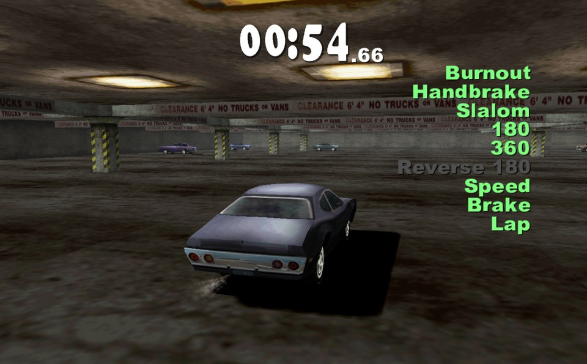
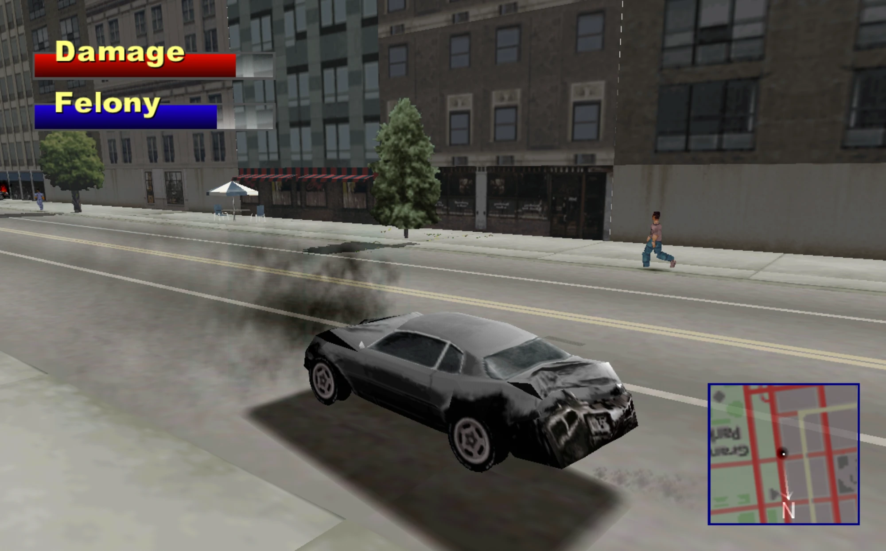
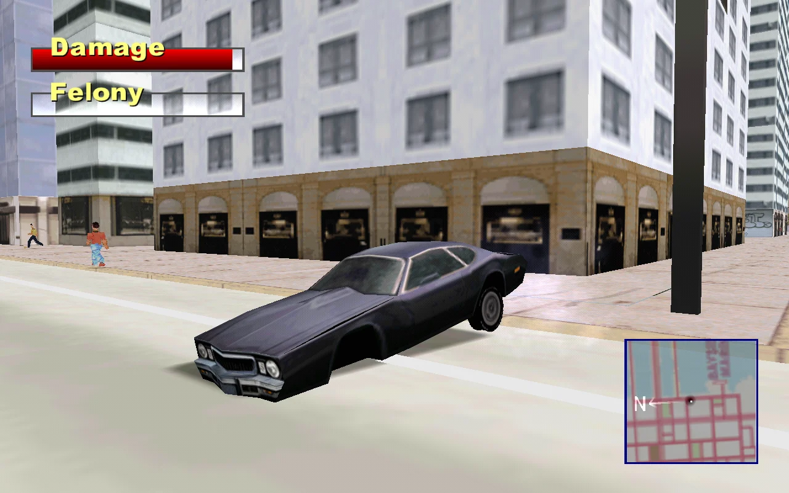
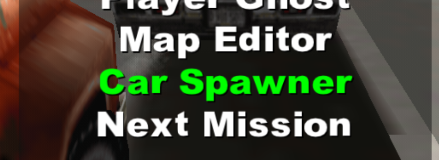
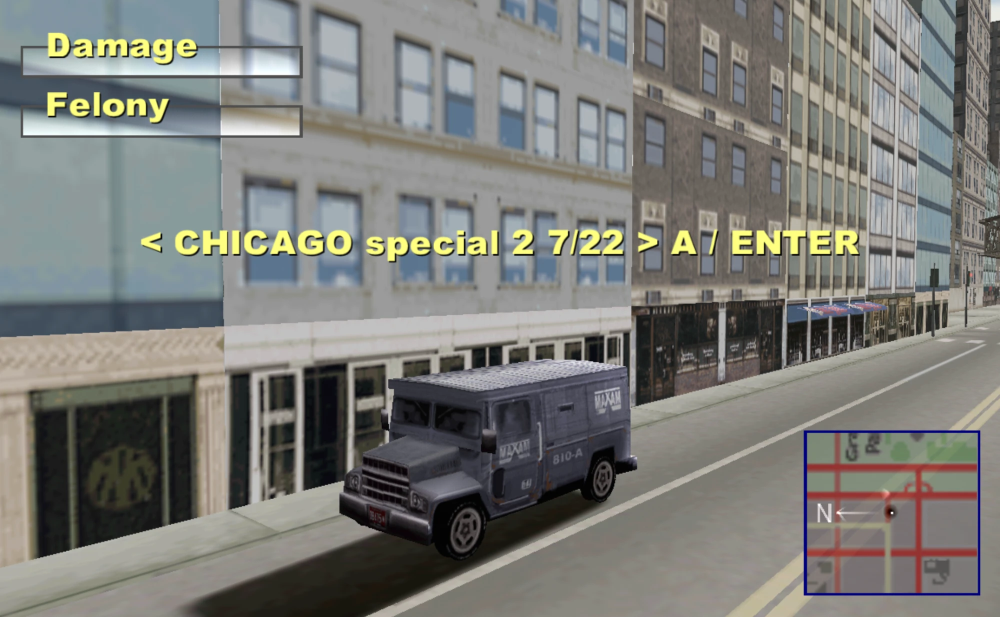
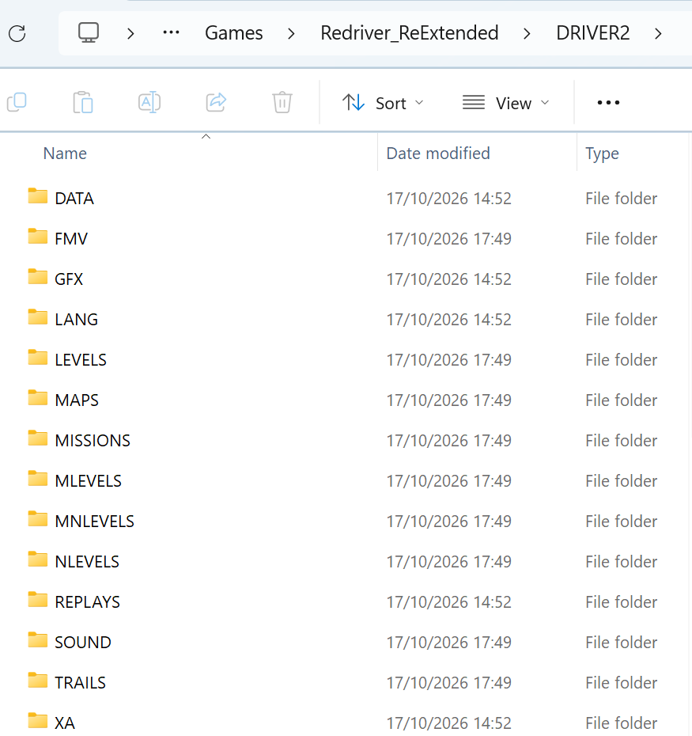
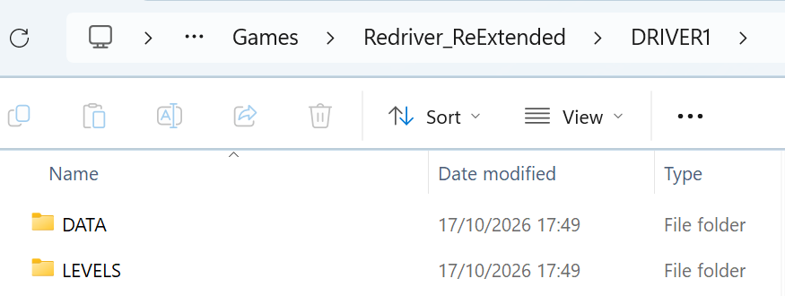

# Redriver ReExtended

**Driver 2 on PC, extended with the Driver 1 cities, a free camera, on-foot play, weather, a day and night cycle, a 10x draw distance and an in-game map editor.**

Redriver ReExtended is a fork of [REDRIVER2](https://github.com/OpenDriver2/REDRIVER2) (the reverse-engineered Driver 2 by SoapyMan and contributors). Everything in the original game still works as before; the new features are optional and can be switched on in the menu.

> **No game data is included.** You need your own copy of Driver 2 (PlayStation, required) and optionally Driver 1 (PlayStation, for the extra cities). Nothing of either game is distributed here: the Driver 1 cities are converted on your own PC, from your own disc files.


## Download (v0.2 beta)

Do not want to build it? Download **Redriver_ReExtended_v0.2-beta.zip** from the [Releases page](https://github.com/E75/Redriver_ReExtended/releases), unzip it and follow "Set up (5 steps)" below.

> **Beta, and updates are likely but not guaranteed.** I will most probably keep improving this, but I have a busy life, so new versions can take a while or come in bursts. Bug reports are welcome as GitHub issues; please say which city and what you were doing, and attach `REDRIVER2.log` when you can.

## What is new

| Feature | Screenshot |
|---|---|
| **Driver 1 cities** in Take a Ride: Miami, San Francisco, Los Angeles (night), New York, Newcastle and the (empty) Training ground, with Driver 2 traffic, cops, pedestrians and on-foot play. 26 Driver 1 story missions under Undercover > D1 Missions. |  |
| **Draw distance** up to "10x" with distance fog and an HD sky; far objects fade in instead of popping up. |  |
| **Weather**: rain with wet-road reflections, snow, fog. All lights and car lamps work in the weather. |   |
| **Day and night cycle**: a continuous 24 hour clock, the sun moves, shadows follow, the sky blends. |  |
| **Traffic and people** density 1x to 10x, cars that fade in, parked cars, jam breaker, cars that keep their distance and back up when stuck, and a car spawner in the debug menu. |  |
| **Free camera** (on by default): right stick / mouse orbits the chase camera and returns by itself. On foot the camera is GTA style and the pad walks relative to it. |   |
| **Pilotable helicopter** (Chicago and the other Driver 2 cities) with a wider chase camera (180%). |  |
| **Night driving**: volumetric headlights, glowing lamps, car gloss in the sun, broken lamps stay dark. |  |
| **Newcastle and Training ground** (the two smallest Driver 1 levels). |   |
| **Car park and Desert missions** (Undercover > D1 Missions > Car park, Desert): the Driver 1 car park test (burnout, handbrake turn, slalom, 180, 360, reverse 180, speed, brake and a lap within 60 seconds, four hits and you are out), then the desert races, practice laps and free drives with the spoke wheel car. The car park test reads its rules from `IVIEW.BIN` and its voice from `SOUND\VOICES.BLK` of your own Driver 1 disc. |  |
| **Impact dents**: a hit dents the car where it was hit. A hit on the left front dents the left front and leaves the right front whole, a pole in the middle dents the middle, front and rear crumple back to the wheel arches after a few hits, side hits push the doors in and press the roof down. Traffic cars dent the same way and are whole again when they spawn. |  |
| **Lost wheels**: a wheel that took many hard hits, or any hard hit at a nearly wrecked car (99% damage), tears off (Driver 2 and Driver 1 cars, traffic too). The car drops on that corner, drags and pulls to that side; it still drives. Option Impact Dents in the Extended Settings: Off, Sensitive, Less Sensitive (default). |  |
| **Car spawner** (debug menu, pause - Debug Options - Car Spawner): a showroom of every Driver 2 and Driver 1 car. Left and right change the car, Enter drives it. |   |
| **Map editor** (`-editor` or F4 in a dev build): top-down camera, move or delete props, remove collision boxes, saved per city. |  |

More: ground and water backdrops so the Driver 1 cities have no holes, kerb "invisible wall" removal, Driver 1 lane directions and traffic lights, D1 car models with fitted lamps and wheels (see [docs/dev-notes/d1-car-lamp-check.json](docs/dev-notes/d1-car-lamp-check.json)), an all-cities-cars option, and many fixes (endless loops, invisible cars, ped rendering).


## D1 Missions menu

Undercover > D1 Missions lists the converted Driver 1 missions per city (each button shows the city's missions in this order):

| Button | Missions |
|---|---|
| **Miami** | 1. The Bank Job, 2. Hide The Evidence, 3. The Clean Up, 4. Tanner Meets Rufus, 5. Superfly Drive, 6. A Shipment's Coming In, 7. Take Out Di'angio's Car |
| **San Francisco** | 1. The Casino Job, 2. The Briefcase, 3. Visit To The Mall, 4. The Chinatown Pick Up, 5. The Mercy Mission, 6. Tanner And Slater |
| **Los Angeles** | 1. Steal A Cop Car, 2. Lucky To The Doc's, 3. The Chase, 4. Maya, 5. The Maddox Hit, 6. The Beverly Hills Getaway, 7. The Test Run |
| **New York** | 1. Grand Central Station Switch, 2. The Accident, 3. Take A Cab, 4. The Negatives, 5. Rite Of Passage, 6. The Ali Situation |
| **Car park, Desert** | 1. Car park, 2. Car park Drive, 3. Desert Race 1, 4. Desert Race 2, 5. Desert Race 3, 6. Desert Race 4, 7. Desert Practice 1, 8. Desert Practice 2, 9. Desert Practice 3, 10. Desert Practice 4, 11. Desert Drive 1, 12. Desert Drive 2, 13. Desert Drive 3 |

## Set up (5 steps)

1. **Download** the zip from the [Releases page](https://github.com/E75/Redriver_ReExtended/releases) and unzip it.
2. **Driver 2 (required):** copy everything of your Driver 2 disc 1 (`LEVELS`, `DATA`, `MISSIONS`, `SOUND`, ...) into the `DRIVER2` folder next to the exe, and the extra folders of disc 2 (for example `NLEVELS`). If Windows asks about existing files (`DATA`, `GFX`, `LANG`), keep the files of the zip. `DRIVER2\LEVELS\CHICAGO.LEV` must exist.
3. **Driver 1 (optional):** copy the `LEVELS`, `DATA` and `MISSIONS` folders of your Driver 1 disc into a `DRIVER1` folder next to `DRIVER2`, plus the files `IVIEW.BIN` and `SOUND\VOICES.BLK` for the car park test (rules and voice).
4. **Convert Driver 1 once:** in the game Options > Gameplay > Secret > Extended Settings > **Driver 1 DLC** > **Check Driver 1 Data** (about a minute), then switch it **On**. Or run `prepare_driver1.bat`. Details: [docs/DRIVER1_SETUP.md](docs/DRIVER1_SETUP.md).
5. **Start** `REDRIVER2_dev.exe`. Driver 1 cities are under Take a Ride > Driver 1 Cities, the story missions under Undercover > D1 Missions.

Videos and music are optional: put the disc images as `install\Driver2CD1.bin` and `install\Driver2CD2.bin` and run `_convert_cd_fmv_xa.bat` once (needs Java). Without them the game runs without videos.

 

## Settings and controls

- **Extended Settings** (Options > Gameplay > Secret): Draw Distance, Traffic And People, Free Camera, Day Night Cycle, All Cities Cars, Sky, Driver 1 DLC, Impact Dents (Off / Sensitive / Less Sensitive). The same settings are in `config.ini`.
- **Command line:** `-city <n> -mission 50` (start Take a Ride), `-cycle <minutes> -hour <h>`, `-weather 1|3`, `-fog`, `-drawdist 0|1|2`, `-crowd 1..5`, `-onfoot`, `-editor`, `-shot <frame>`.
- **Debug menu** (Pause > Debug Options): Time of Day (Day, Night, Dusk, Dawn, Rain, Snow, Fog), Fun Cheats (Flying Car F8, Infinite Mass F6, Speed Boost Horn, Chopper), Car Spawner, Map Editor (F4).
- **Volumetric lighting** (headlight cones, lamp halos, fog, sun shafts, car gloss) is on by default: Options > Gameplay > Secret > Volumetric Options. Notes: [docs/dev-notes/volumetric-lighting.md](docs/dev-notes/volumetric-lighting.md).

Default controls (modern Xbox layout, analog sticks on; the original layout is a comment in `[controls_game]` of `config.ini`, keyboard unchanged):

| Action | Xbox controller |
|---|---|
| Gas / brake and reverse | RT / LT |
| Steer / walk | left stick |
| Camera | right stick (or mouse) |
| Get in / out of a car | Y |
| Handbrake / sprint, wheelspin | B / A |
| Look left / right, look back | LB / RB, click left stick |
| Horn | click right stick |


## Building (Windows)

Needs Visual Studio 2022 or the Build Tools (v143 or newer), PowerShell and git.

```powershell
git clone --recurse-submodules https://github.com/E75/Redriver_ReExtended.git
cd Redriver_ReExtended
.\windows_dev_prepare.ps1          # downloads premake, SDL2, OpenAL, libjpeg and generates the project; ends in src_rebuild. Its last "open .sln" step reports an error, that is harmless
$env:SDL2_DIR = ".\dependencies\SDL2-2.30.2"      # only needed again when you start a new PowerShell window
$env:OPENAL_DIR = ".\dependencies\openal-soft-1.23.1-bin"
$env:JPEG_DIR = ".\dependencies\jpeg-9d"
.\premake5.exe vs2022              # only needed again after adding source files
MSBuild build\REDRIVER2.sln -p:Configuration=Release_dev -p:Platform=Win32 -m
```

(`MSBuild` is in the "Developer PowerShell for VS"; with the Build Tools add `-p:PlatformToolset=v145` or the version you have installed.)

The exe is written to `src_rebuild\bin\Release_dev`. The two DLLs it needs are not built: copy `src_rebuild\dependencies\SDL2-2.30.2\lib\x86\SDL2.dll` next to the exe, and `src_rebuild\dependencies\openal-soft-1.23.1-bin\bin\Win32\soft_oal.dll` as `OpenAL32.dll`. Only the 32 bit Windows build is tested.

## Credits

- Everything of the original reverse engineering: **SoapyMan**, **Fireboyd78**, **Krishty**, **someone972**, **Gh0stBlade** (Psy-X base), Ben Lincoln (TDR), Stohrendorf (Symdump) and the other [OpenDriver2](https://github.com/OpenDriver2) contributors.
- The ReExtended features (Driver 1 conversion, weather, cycle, camera, editor and the fixes) were made by E75 with the help of Claude.
- Driver and Driver 2 are trademarks of their owners. This project contains no game assets and is not affiliated with Ubisoft or Reflections.

License: MIT (see [LICENSE](LICENSE)). The graphics layer lives in [E75/PsyCross](https://github.com/E75/PsyCross) (also MIT, based on the [OpenDriver2 PsyCross](https://github.com/OpenDriver2/PsyCross)).

Developer notes (formats, engine findings, plans): [docs/DEVELOPER_NOTES.md](docs/DEVELOPER_NOTES.md) and [docs/dev-notes/](docs/dev-notes/).
