# Redriver ReExtended

**Driver 2 on PC, extended with the Driver 1 cities, a free camera, on-foot play, weather, a day and night cycle, a 10x draw distance and an in-game map editor.**

Redriver ReExtended is a fork of [REDRIVER2](https://github.com/OpenDriver2/REDRIVER2) (the reverse-engineered Driver 2 by SoapyMan and contributors). Everything in the original game still works as before; the new features are optional and can be switched on in the menu.

> **No game data is included.** You need your own copy of Driver 2 (PlayStation, required) and optionally Driver 1 (PlayStation, for the extra cities). Nothing of either game is distributed here: the Driver 1 cities are converted on your own PC, from your own disc files.

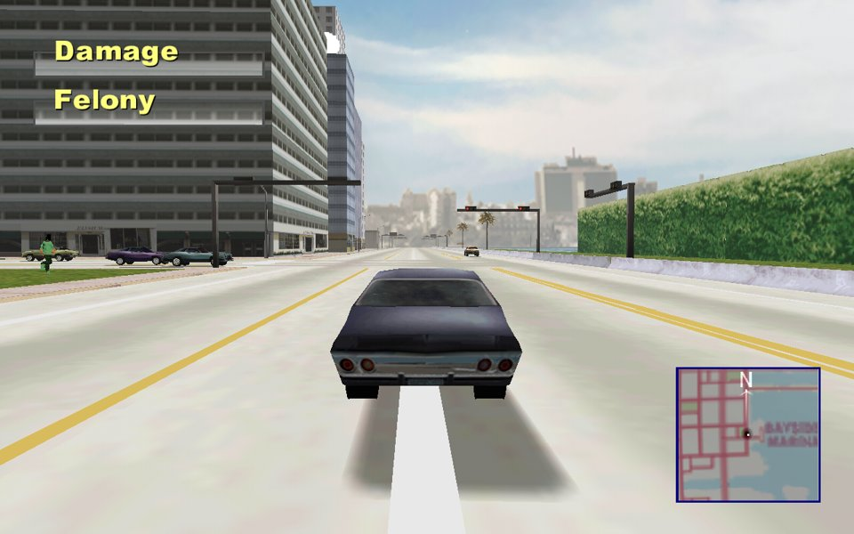

## Download (v0.1 beta)

Do not want to build it? Download **Redriver_ReExtended_v0.1-beta.zip** from the [Releases page](https://github.com/E75/Redriver_ReExtended/releases), unzip it and follow "How to set it up with your own game files" below (you only add your own Driver 2 files, and optionally Driver 1).

> **Beta, and updates are likely but not guaranteed.** I will most probably keep improving this, but I have a busy life, so new versions can take a while or come in bursts. Bug reports are welcome as GitHub issues; please say which city and what you were doing, and attach `REDRIVER2.log` when you can.

## What is new

| Feature | Screenshot |
|---|---|
| **Driver 1 cities** in Take a Ride: Miami, San Francisco, Los Angeles (night), New York, Newcastle and the (empty) Training ground, with Driver 2 traffic, cops, pedestrians and on-foot play. 24 Driver 1 story missions under Undercover > D1 Missions. | 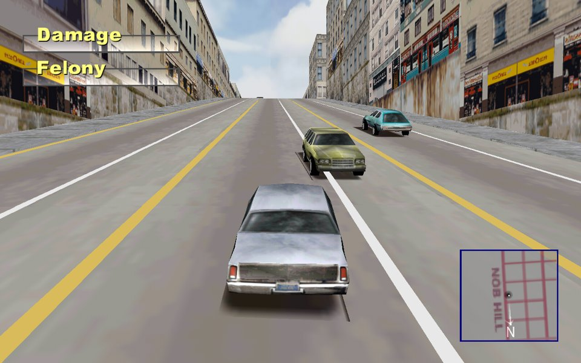 |
| **Draw distance** up to "10x" with distance fog and an HD sky; far objects fade in instead of popping up. | 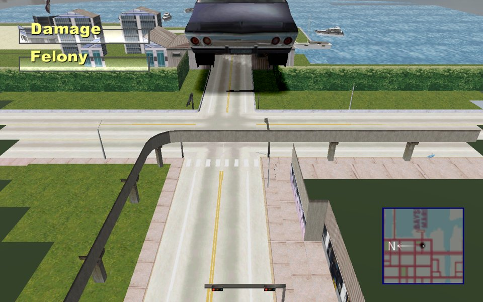 |
| **Weather**: rain with wet-road reflections, snow, fog. All lights and car lamps work in the weather. | 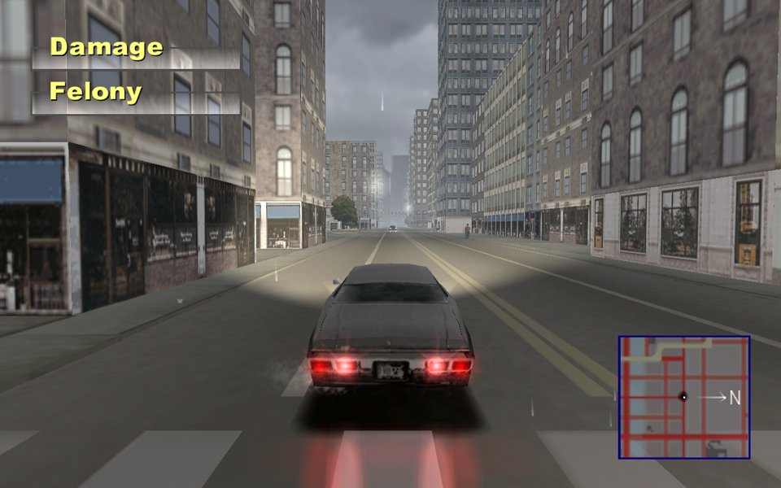 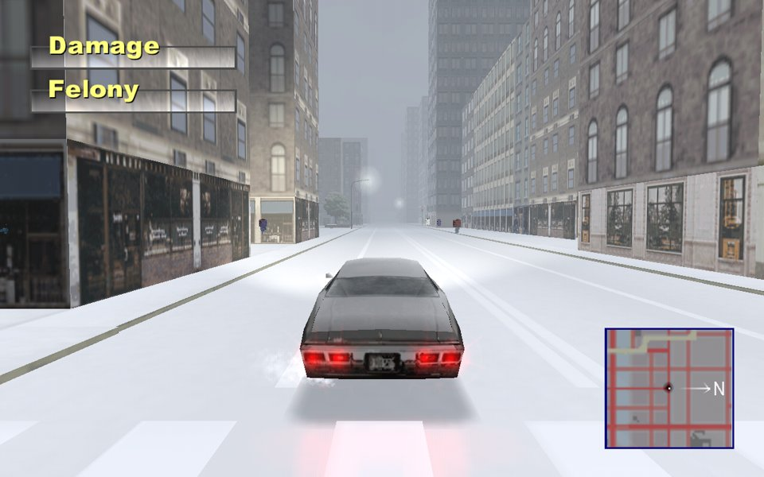 |
| **Day and night cycle**: a continuous 24 hour clock, the sun moves, shadows follow, the sky blends. | 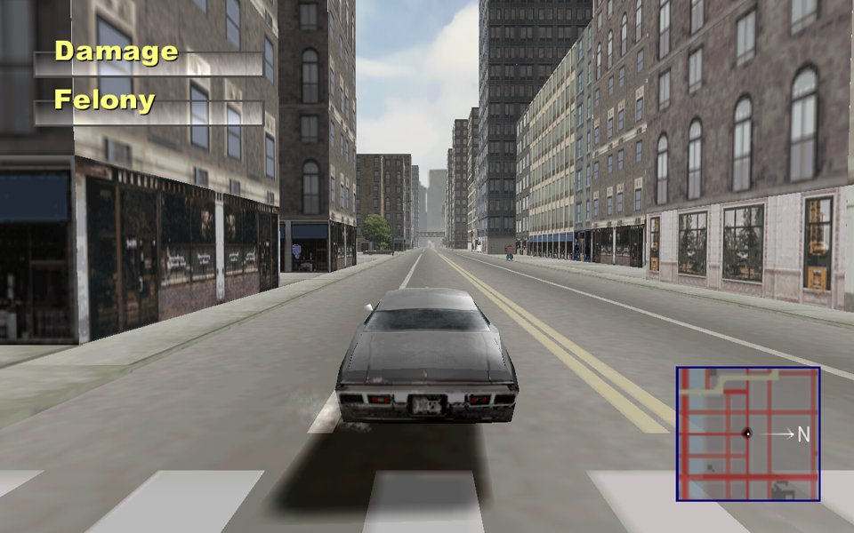 |
| **Traffic and people** density 1x to 10x, cars that fade in, parked cars, jam breaker. | 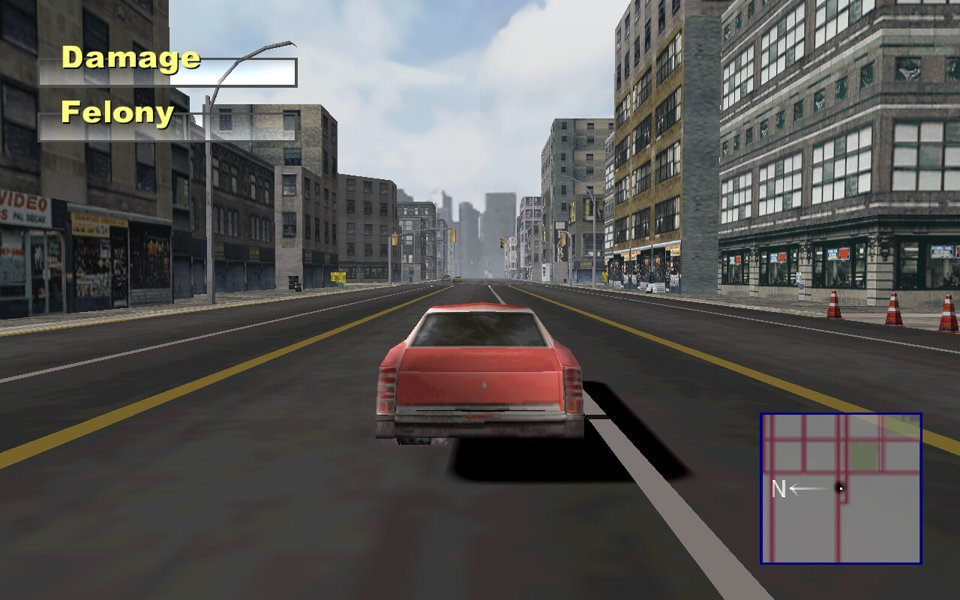 |
| **Free camera** (on by default): right stick / mouse orbits the chase camera and returns by itself. On foot the camera is GTA style and the pad walks relative to it. | 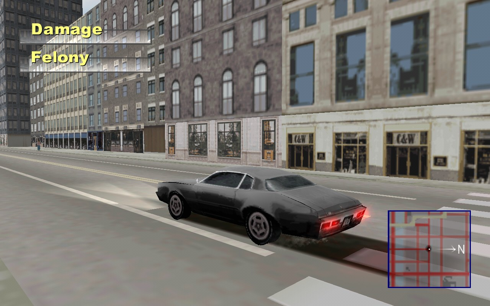 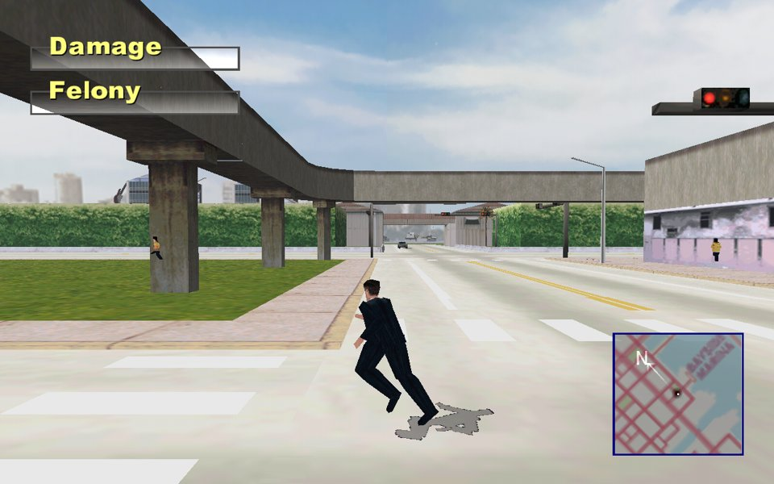 |
| **Pilotable helicopter** (Chicago and the other Driver 2 cities) with a wider chase camera (180%). | 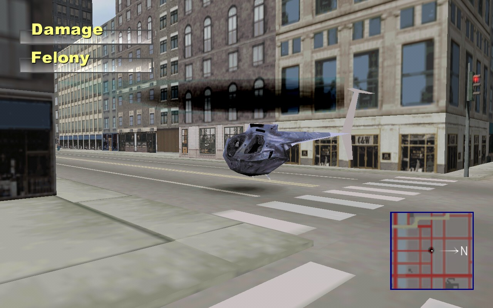 |
| **Night driving**: volumetric headlights, glowing lamps, car gloss in the sun, broken lamps stay dark. | 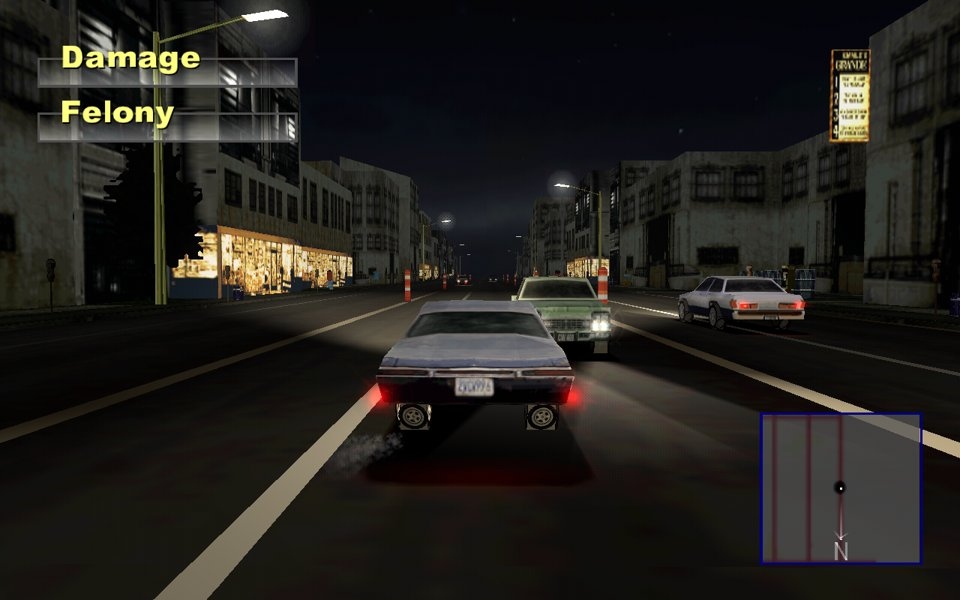 |
| **Newcastle and Training ground** (the two smallest Driver 1 levels). | 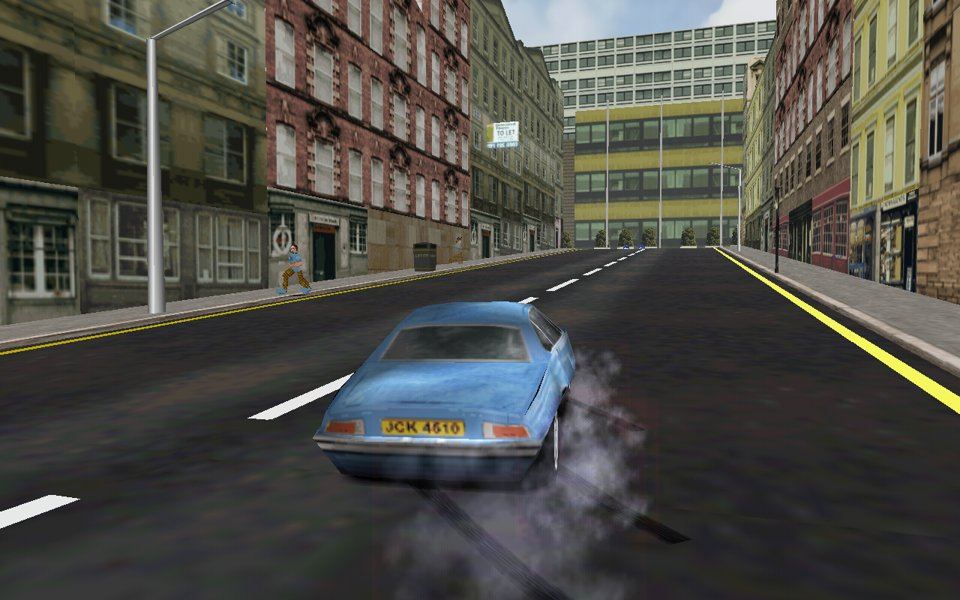 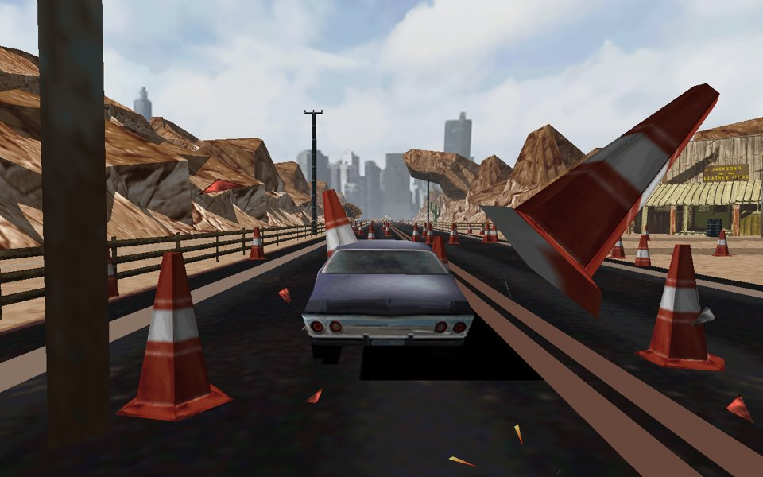 |
| **Map editor** (`-editor` or F4 in a dev build): top-down camera, move or delete props, remove collision boxes, saved per city. | 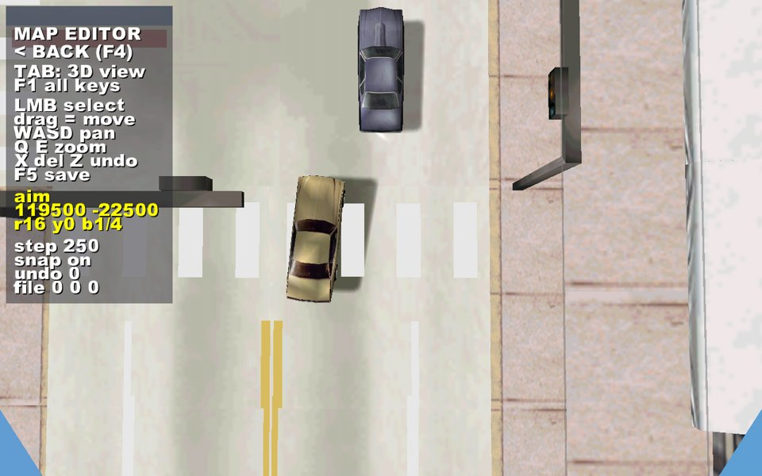 |

More: ground and water backdrops so the Driver 1 cities have no holes, kerb "invisible wall" removal, Driver 1 lane directions and traffic lights, D1 car models with fitted lamps and wheels (see [docs/dev-notes/d1-car-lamp-check.json](docs/dev-notes/d1-car-lamp-check.json)), an all-cities-cars option, and many fixes (endless loops, invisible cars, ped rendering).

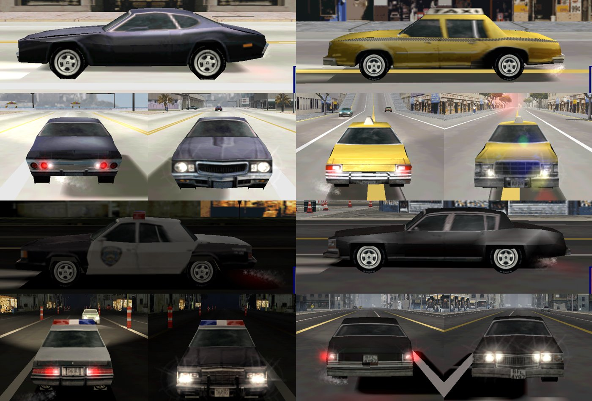

## Volumetric lighting

Lights in the original game are flat sprites. Redriver ReExtended adds a small light volume pass (PsyCross renderer, `PsyX_postfx.cpp`) that is on by default and can be switched off under Options - Gameplay - Secret - Volumetric Options:

- **Lamp and headlight cones**: up to 16 lights per frame (head lamps, street lamps, traffic lights) are handed to the renderer, which adds an analytic in-scattering term along each view ray. In the dark, rain or fog a headlight shows a soft cone and every lamp a halo, instead of only a sprite. A broken lamp gives no cone, no halo and no light pool on the road.
- **Atmospheric fog**: fog has height and takes the colour of the sky and the sun, so far buildings fade into the haze instead of popping up.
- **Sun shafts** (god rays): a radial blur from the sun over the sky pixels only, so rays run along building edges by day. Costs about 0.6 ms of GPU time.
- **Car gloss**: in sunlight the car body gets a second additive pass with a tight sun highlight and a faint sky reflection; it fades out at night, in rain and in fog.
- **Dynamic road pools**: the headlights of the player and of traffic light up the road in front of them; lights never shine through the ground in the rain.

The design notes are in [docs/dev-notes/volumetric-lighting.md](docs/dev-notes/volumetric-lighting.md), [part 2 (lamps)](docs/dev-notes/volumetric-lighting-part2-lamps.md) and [part 3 (sun shafts)](docs/dev-notes/volumetric-lighting-part3-sunshafts.md).

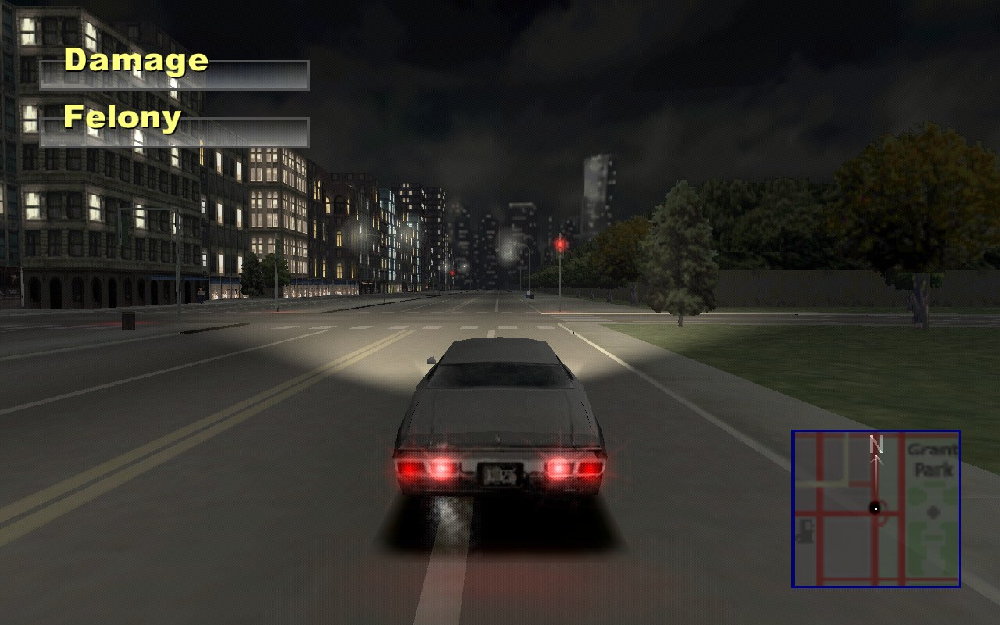

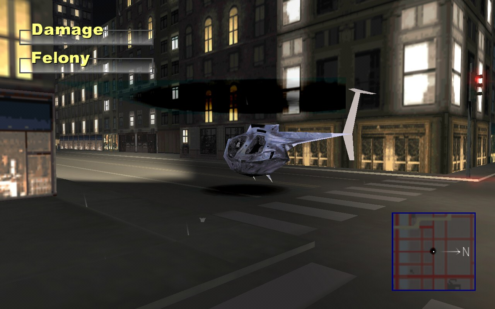

## Cinematic views

Use the free camera (right stick or mouse) or `-camangle <n>` for side and rear quarter views, and `-choppertest` to fly the helicopter.

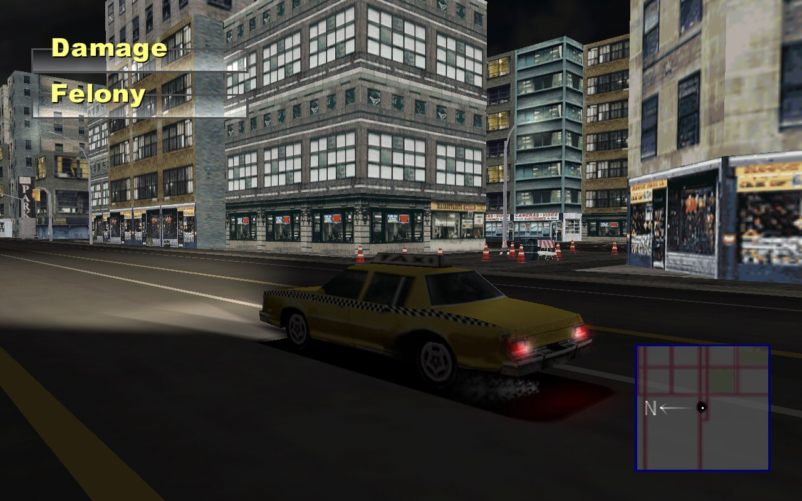

## How to set it up with your own game files

### 1. Get the game

Either download a build from the Releases page (if there is one) or build it yourself (see below). You get `REDRIVER2_dev.exe` and a few DLLs (`SDL2.dll`, `OpenAL32.dll`).

### 2. Driver 2 files (required)

1. Make a game folder and put the exe and the two DLLs (`SDL2.dll`, `OpenAL32.dll`, see Building below) in it.
2. Copy the contents of the `data` folder of this repository into it (`config.ini`, `DRIVER2\`, `install\`).
3. Put your Driver 2 CD images next to the install folder as `install\Driver2CD1.bin` and `install\Driver2CD2.bin` (the game reads them directly; the path is `[cdfs] image=` in `config.ini`). Videos and music are converted once with `_convert_cd_fmv_xa.bat` (needs Java; it uses the included jpsxdec).
4. Start `REDRIVER2_dev.exe`. The detailed original instructions are in the [upstream wiki](https://github.com/OpenDriver2/REDRIVER2/wiki/Installation-instructions).

### 3. Driver 1 cities (optional)

1. Copy the `LEVELS` and `DATA` folders of your Driver 1 disc into a folder `DRIVER1` next to the `DRIVER2` folder:

   ```
   REDRIVER2_dev.exe
   config.ini
   DRIVER2\...
   DRIVER1\LEVELS\MIAMI.LEV, FRISCO.LEV, LA.LEV, NEWYORK.LEV, CREDITS.LEV, TRAIN.LEV
   DRIVER1\DATA\...
   DRIVER1\MISSIONS\MISSION.BLK      (for the story missions)
   ```

2. Convert once, either:
   - run `tools\prepare_driver1.bat` (copy it next to the exe first), or
   - in the game: Options > Gameplay > Secret > Extended Settings > **Driver 1 DLC** > **Check Driver 1 Data**. A message asks you to wait (about a minute). Then switch the option **On**.
3. The result is stored in `config.ini` (`[d1dlc]`), so the game never scans again. The converted files are written to `DRIVER1\CONVERTED\` on your PC.
4. Take a Ride > **Driver 1 Cities**, or Undercover > **D1 Missions**.

See [docs/DRIVER1_SETUP.md](docs/DRIVER1_SETUP.md) for details and troubleshooting.

### 4. Switching the new features on

Options > Gameplay > Secret > **Extended Settings** lists: Draw Distance, Traffic And People, Free Camera, Day Night Cycle, All Cities Cars, Sky, Driver 1 DLC. Weather and time of day can be changed in the debug pause menu, and `config.ini` has the same settings (`[game]`, `[render]`, `[d1dlc]`).

Useful options on the command line: `-city <n> -mission 50` (start Take a Ride directly), `-cycle <minutes> -hour <h>`, `-weather 1|3`, `-fog`, `-drawdist 0|1|2`, `-crowd 1..5`, `-onfoot`, `-editor`, `-shot <frame>` (writes `SCREENSHOT.BMP`).

### 5. Controls and the debug menu

The default `config.ini` uses modern (GTA style) Xbox controls and the analog sticks are on from the start:

| Action | Xbox controller |
|---|---|
| Gas / brake and reverse | RT / LT |
| Steer / walk | left stick |
| Camera (free camera) | right stick (or the mouse) |
| Get in / out of a car | Y |
| Handbrake / sprint, wheelspin | B / A |
| Look left / right | LB / RB |
| Look back | click left stick |
| Horn | click right stick |

The original PlayStation layout is kept as a comment in `[controls_game]` of `config.ini`. Keyboard controls are unchanged.

Pause (Esc / Start) > **Debug Options** has extra options, most of them new:

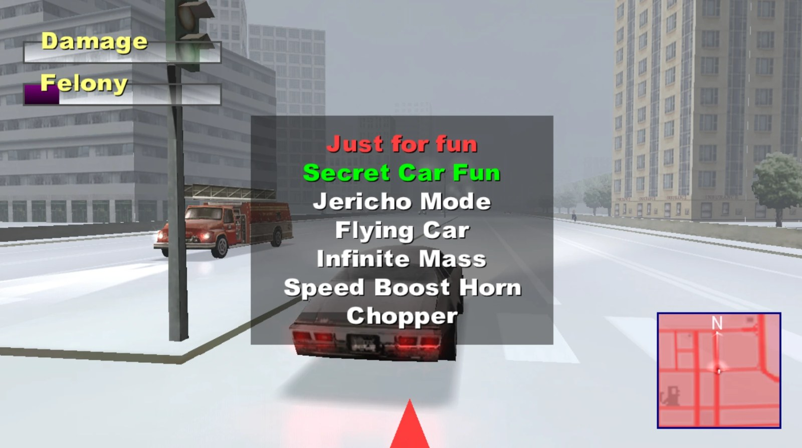

- **Time of Day**: Day, Night, Dusk, Dawn and Clear, Rain, **Snow**, **Fog**.
- **Fun Cheats**: Secret Car Fun, Jericho Mode, **Flying Car** (F8), **Infinite Mass** (F6, the car is not pushed by other cars), **Speed Boost Horn** (hold the horn to push the car forward, fun together with Infinite Mass) and **Chopper** (fly the helicopter).
- **Map Editor** (F4): see above.

In debug builds (this download) the game also writes `CAMSTATE.txt` next to the exe while paused: the exact camera angles and render counters. Attach it to a bug report about a glitchy camera.

## Building (Windows)

Needs Visual Studio 2022 or the Build Tools (v143 or newer), PowerShell and git.

```powershell
git clone --recurse-submodules https://github.com/E75/Redriver_ReExtended.git
cd Redriver_ReExtended
.\windows_dev_prepare.ps1          # downloads premake, SDL2, OpenAL, libjpeg and generates the project; ends in src_rebuild. Its last "open .sln" step reports an error, that is harmless
$env:SDL2_DIR = ".\dependencies\SDL2-2.30.2"      # only needed again when you start a new PowerShell window
$env:OPENAL_DIR = ".\dependencies\openal-soft-1.23.1-bin"
$env:JPEG_DIR = ".\dependencies\jpeg-9d"
.\premake5.exe vs2022              # only needed again after adding source files
MSBuild build\REDRIVER2.sln -p:Configuration=Release_dev -p:Platform=Win32 -m
```

(`MSBuild` is in the "Developer PowerShell for VS"; with the Build Tools add `-p:PlatformToolset=v145` or the version you have installed.)

The exe is written to `src_rebuild\bin\Release_dev`. The two DLLs it needs are not built: copy `src_rebuild\dependencies\SDL2-2.30.2\lib\x86\SDL2.dll` next to the exe, and `src_rebuild\dependencies\openal-soft-1.23.1-bin\bin\Win32\soft_oal.dll` as `OpenAL32.dll`. Only the 32 bit Windows build is tested.

## Credits

- Everything of the original reverse engineering: **SoapyMan**, **Fireboyd78**, **Krishty**, **someone972**, **Gh0stBlade** (Psy-X base), Ben Lincoln (TDR), Stohrendorf (Symdump) and the other [OpenDriver2](https://github.com/OpenDriver2) contributors.
- The ReExtended features (Driver 1 conversion, weather, cycle, camera, editor and the fixes) were made by E75 with the help of Claude.
- Driver and Driver 2 are trademarks of their owners. This project contains no game assets and is not affiliated with Ubisoft or Reflections.

License: MIT (see [LICENSE](LICENSE)). The graphics layer lives in [E75/PsyCross](https://github.com/E75/PsyCross) (also MIT, based on the [OpenDriver2 PsyCross](https://github.com/OpenDriver2/PsyCross)).

Developer notes (formats, engine findings, plans): [docs/DEVELOPER_NOTES.md](docs/DEVELOPER_NOTES.md) and [docs/dev-notes/](docs/dev-notes/).
